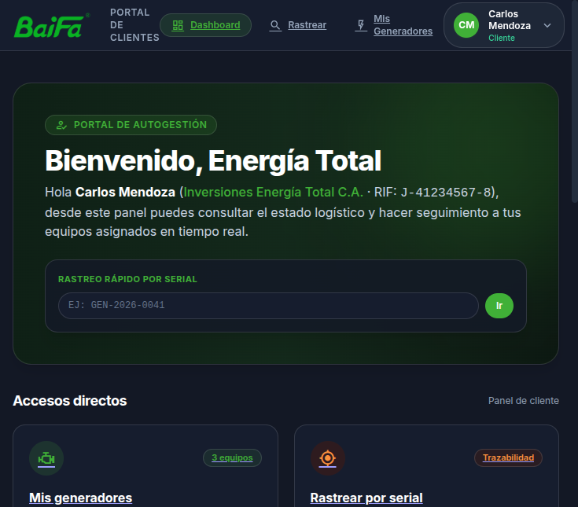
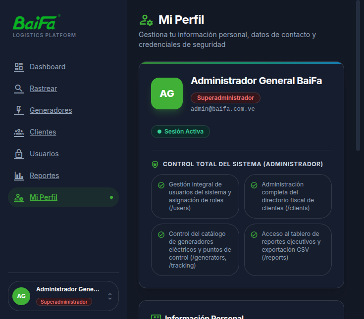

# 📄 Informe Ejecutivo de Entrega Final — Etapa 5 y Versión `v1.0.8`

**Proyecto:** Plataforma de Control Logístico y Trazabilidad de Generadores Eléctricos — **BaiFa Power C.A.**  
**Versión Oficial Entregada:** `v1.0.8` (`release/v1.0.8`)  
**Fecha de Emisión:** Noviembre 2026  
**Estado General del Proyecto:** ✅ **5 de 5 Etapas Planificadas Culminadas (100% Operativo)**  

---

## 🎯 1. Resumen Ejecutivo

Hacemos entrega formal de la **culminación total de la planificación acordada (Etapas 1 a 5)** junto con la actualización mayor **`v1.0.8`** de la plataforma **BaiFa Power Logistics**.  

Con el cierre de la **Etapa 5 (Tablero de Reportes Ejecutivos y Portal de Clientes)** y los ajustes operativos y de identidad visual realizados, el sistema cubre de extremo a extremo todo el ciclo comercial y logístico de BaiFa Power: desde la emisión de la orden de compra internacional hasta la entrega final en las instalaciones del cliente, con control de roles, notificaciones automáticas por correo electrónico, consulta rápida pública y reportes exportables.

---

## 📊 2. Estatus Actual del Proyecto (Planificación Completa — Etapas 1 a 5)

| Etapa | Módulo del Negocio | Alcance Funcional Entregado | Estado Actual |
| :---: | :--- | :--- | :---: |
| **Etapa 1** | **Control de Accesos y Directorio de Clientes** | Autenticación segura (Laravel Sanctum), Control de Acceso por Roles (`admin`, `manager`, `employee`, `client`), registro empresarial con validación de RIF, directorio fiscal de clientes y gestión de perfil propio (`/profile`). | ✅ **100% Entregada** |
| **Etapa 2** | **Catálogo de Generadores e Inventario** | Ficha técnica de plantas eléctricas (serial único de fábrica, modelo, capacidad en kVA, ETA, fotografía referencial y vinculación al cliente comprador) y filtros interactivos. | ✅ **100% Entregada** |
| **Etapa 3** | **Puntos de Control y Notificaciones por Correo** | Actualización manual de ruta por el equipo operativo a lo largo de **7 estados logísticos** estandarizados y envío automático de correos institucionales al cliente en cada avance. | ✅ **100% Entregada** |
| **Etapa 4** | **Bitácora Histórica y Consulta Rápida de Ruta** | Línea de tiempo cronológica e inmutable con registro de usuario y fecha exacta, más pantalla de rastreo público por serial estilo guía de encomienda con privacidad de datos fiscales. | ✅ **100% Entregada** |
| **Etapa 5** | **Portal de Clientes y Tablero de Reportes** | Portal exclusivo para clientes con buscador rápido por serial y barra de progreso porcentual, junto al Tablero Ejecutivo de Reportes (`/reports`) con métricas por estado, filtros y exportación CSV. | ✅ **100% Entregada** |

---

## 🚀 3. Detalle de Cambios e Implementaciones en la Versión `v1.0.8`

### 3.1. Nuevos 7 Estados Logísticos del Generador
Se adecuó la máquina de estados en base de datos, API REST, interfaz web y correos transaccionales para reflejar con exactitud el flujo real de importación y despacho de **BaiFa Power**:

| Fase | Identificador | Etiqueta en Plataforma | Significado Operativo |
| :---: | :--- | :--- | :--- |
| **1** | `purchase_order` | **Orden de Compra** | Orden de compra emitida y confirmada para el generador. |
| **2** | `in_production` | **En Producción** | Unidad en línea de ensamblaje y pruebas en fábrica. |
| **3** | `origin_customs` | **En Aduana de Origen** | Trámites de exportación y despacho en puerto de origen. |
| **4** | `maritime_transit` | **En Tránsito Marítimo** | Embarcado en buque de carga en navegación hacia puerto destino. |
| **5** | `destination_customs` | **En Aduana Destino** | Arribo a puerto nacional y proceso de desaduanamiento. |
| **6** | `baifa_warehouse` | **En Almacén BaiFa** | Equipo verificado y resguardado en almacén central BaiFa. |
| **7** | `delivered` | **Entregado** | Generador entregado formalmente en las instalaciones del cliente. |

---

### 3.2. Integración del Logotipo Oficial de BaiFa® (Versiones Dark y Light)
* Se integraron los logotipos originales de **BaiFa®** en alta definición con fondo transparente:
  * **Versión Verde (`logo-baifa-green.png`):** Aplicada en el menú lateral del panel administrativo, cabecera del Portal de Clientes, vista pública de rastreo y encabezados de formularios de acceso.
  * **Versión Blanca (`logo-baifa-white.png`):** Aplicada en el panel institucional de bienvenida de las vistas de inicio de sesión y registro.

---

### 3.3. Culminación de la Etapa 5: Tablero de Reportes y Portal de Clientes
* **Tablero de Reportes Ejecutivos (`/reports` — Roles `admin` y `manager`):**
  * **7 Tarjetas Interactivas de Estado:** Conteo y porcentaje (`% del total`) de la flota por cada una de las 7 etapas logísticas, con filtrado rápido al hacer clic.
  * **Pestañas Consolidadas:** Vistas de **Generadores** (separados en *Activos en proceso* y *Entregados*), **Clientes** (activos, inactivos y cantidad de equipos asignados) y **Usuarios**.
  * **Exportación CSV:** Descarga instantánea de reportes filtrados compatibles con Microsoft Excel (formato UTF-8).
* **Portal de Clientes (`/`, `/generators`, `/tracking`):**
  * **Buscador Rápido por Serial** integrado en el banner de bienvenida.
  * **Indicador de Progreso Logístico (%)** en cada unidad asignada acorde al avance dentro de las 7 etapas.

---

### 3.4. Rol de Empleado (`employee`) con Acceso Operativo Limitado
Para reforzar la seguridad interna y segregación de funciones, el perfil **Empleado** opera bajo permisos controlados tanto en la interfaz web como en los endpoints del servidor:

* **Accesos Permitidos:**
  * Consulta del **Dashboard** operativo y **Rastreo (`/tracking`)**.
  * Registro, edición y actualización manual de puntos de control en **Generadores (`/generators`)**.
  * Consulta en **modo solo lectura** del directorio de **Clientes (`/clients`)** (con indicador visual `Modo consulta (Empleado)`).
  * Gestión de su propio perfil en **`Mi Perfil` (`/profile`)**.
* **Restricciones Aplicadas:**
  * Sin acceso al módulo de **Usuarios (`/users`)** ni al tablero de **Reportes Ejecutivos (`/reports`)**.
  * Sin permiso para crear, editar, desactivar o eliminar empresas clientes, ni para eliminar generadores del catálogo.

---

### 3.5. Pantalla de Gestión de Perfil (`Mi Perfil` — `/profile`) para Todos los Roles
Todo usuario autenticado (**Cliente**, **Empleado**, **Jefe / Gerente** y **Administrador**) dispone ahora del módulo **`Mi Perfil`** accesible desde el menú de navegación y el menú de usuario:
* Visualización de identidad, rol asignado y resumen de permisos activos.
* Edición validada de **Nombre completo** y **Correo electrónico**.
* Para cuentas **Cliente (`client`)**, edición sincronizada de los datos corporativos de su empresa (**Razón Social**, **Nombre Comercial**, **RIF** y **Teléfonos**).
* Sección independiente de **Cambio Seguro de Contraseña** (requiere verificación de la contraseña actual).

---

## 📦 4. Entregables de Despliegue y Respaldo (`v1.0.8`)

* **Repositorios GitHub (`release/v1.0.8`):** Código fuente actualizado, etiquetado y publicado en `baifa-api`, `baifa-ui` y `baifa-docs`.
* **Imágenes Docker Hub (`release-1.0.8`):** Publicadas en `juaneliezer13/baifa-api:release-1.0.8` y `juaneliezer13/baifa-ui:release-1.0.8`.
* **Paquetes Compilados para cPanel (`baifa-builds/`):**
  * `baifa-ui-cpanel.zip` (SPA estático precompilado con exclusión de `/api`).
  * `baifa-api-cpanel.zip` (Backend Laravel optimizado para PHP 8.2+).
  * `database_cpanel_init.sql` (Respaldo íntegro de la base de datos actualizada listo para importar en phpMyAdmin).

---

*Informe emitido para la revisión, validación y conformidad de cierre de la Etapa 5 — **BaiFa Power C.A.** (Noviembre 2026).*
