# ⚡ Manual de Usuario Interactivo — BaiFa Power Tracking (`v1.0.8`)

> 💡 **Bienvenido a BaiFa Power Tracking.** Esta guía ha sido escrita sin tecnicismos para explicar de forma clara qué hace cada pantalla del sistema, qué correos automáticos envía y qué puede hacer cada tipo de usuario.

---

## 🧭 Mapa Interactivo de Casos de Uso por Tipo de Usuario

Cada persona que entra a BaiFa ve únicamente las herramientas que necesita para su trabajo. El siguiente mapa muestra de un vistazo cómo interactúa cada perfil con la plataforma:

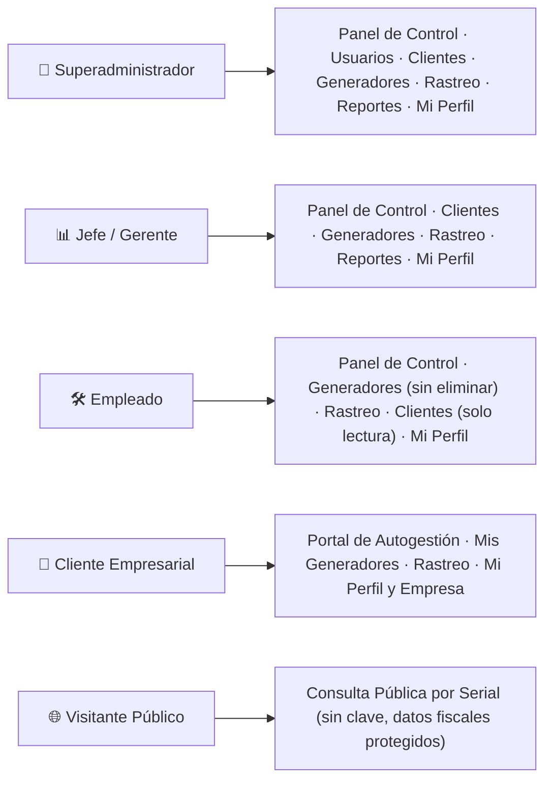

### 📋 Matriz Comparativa Rápida de Permisos

| Funcionalidad / Módulo | 👑 Superadmin | 📊 Jefe / Gerente | 🛠️ Empleado | 🏢 Cliente | 🌐 Visitante |
| :--- | :---: | :---: | :---: | :---: | :---: |
| **Panel de Control (Resumen general)** | ✅ Global | ✅ Global | ✅ Operativo | ✅ Su Portal | — |
| **Rastreo por Serial e Historial** | ✅ Completo | ✅ Completo | ✅ Completo | ✅ Sus equipos | 👁️ Sin datos fiscales |
| **Ver Catálogo de Generadores** | ✅ Todos | ✅ Todos | ✅ Todos | ✅ Solo suyos | — |
| **Registrar y Editar Generadores** | ✅ Sí | ✅ Sí | ✅ Sí | — | — |
| **Actualizar Estado / Punto de Control** | ✅ Sí | ✅ Sí | ✅ Sí | — | — |
| **Eliminar Generadores** | ✅ Sí | ✅ Sí | — (Bloqueado) | — | — |
| **Directorio de Clientes** | ✅ Gestión total | ✅ Gestión total | 👁️ Solo lectura | — | — |
| **Gestión de Usuarios del Sistema** | ✅ Gestión total | — | — | — | — |
| **Reportes Ejecutivos y Exportar Excel** | ✅ Todas las pestañas | ✅ Todas las pestañas | — | — | — |
| **Mi Perfil y Cambio de Contraseña** | ✅ Personal | ✅ Personal | ✅ Personal | ✅ Personal + Empresa | — |

### 🔍 Desglose de Casos de Uso por Perfil (Haz clic para desplegar cada rol)

<strong>👑 Superadministrador</strong> — <em>Control Total</em>

- **¿Quién usa este perfil?** Dirección General o responsable principal de la plataforma en BaiFa Power.
- **Qué puede hacer:** Tiene el control absoluto de todo el sistema: crea cuentas para el personal interno, administra el directorio de clientes, registra generadores, actualiza sus recorridos, revisa los reportes ejecutivos y gestiona su propio perfil.
- **Pantallas que ve:** Menú lateral completo: Dashboard · Rastrear · Generadores · Clientes · Usuarios · Reportes · Mi Perfil

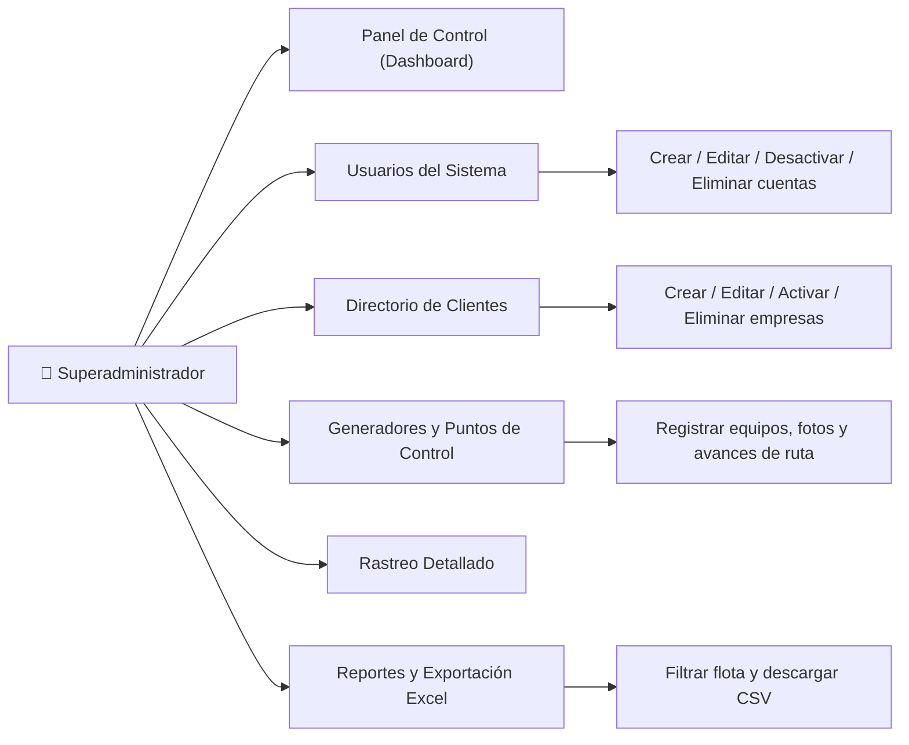

| Caso de Uso (Qué necesita hacer) | Dónde entra | Cómo funciona |
| :--- | :--- | :--- |
| **Crear cuentas para su equipo de trabajo** | Usuarios → + Nuevo usuario | Registra gerentes, empleados u otros administradores; el sistema envía al usuario un correo automático con sus credenciales. |
| **Activar, suspender o eliminar un usuario** | Usuarios → Acciones de la fila | Cambia el interruptor Activo/Inactivo o elimina cuentas que ya no deban entrar. |
| **Registrar y administrar empresas clientes** | Clientes → + Nuevo cliente | Guarda los datos fiscales (RIF, razón social, contacto), crea automáticamente su acceso cliente y le envía un correo de bienvenida. |
| **Registrar generadores y asignarles cliente** | Generadores → + Registrar Generador | Carga serial, modelo, potencia (kVA), fecha estimada de llegada, fotografía y empresa compradora. |
| **Actualizar el estado y puntos de control** | Generadores o Rastrear → Registrar Checkpoint | Registra cada avance de etapa; el sistema guarda el historial y avisa por correo al cliente. |
| **Consultar métricas y exportar a Excel** | Reportes → Exportar CSV | Revisa porcentajes por etapa logística, filtra por cliente o estado y descarga el reporte. |
| **Actualizar sus propios datos o contraseña** | Mi Perfil | Cambia su nombre, correo o clave de ingreso de forma segura. |

<strong>📊 Jefe / Gerente</strong> — <em>Supervisión Operativa</em>

- **¿Quién usa este perfil?** Gerentes de Operaciones, Logística o Ventas encargados de supervisar entregas y clientes.
- **Qué puede hacer:** Supervisa toda la operación comercial y logística: administra clientes y generadores (incluyendo eliminar registros si hubo un error), actualiza puntos de control y consulta reportes ejecutivos con exportación a Excel. No gestiona contraseñas ni altas de usuarios internos.
- **Pantallas que ve:** Menú lateral operativo: Dashboard · Rastrear · Generadores · Clientes · Reportes · Mi Perfil

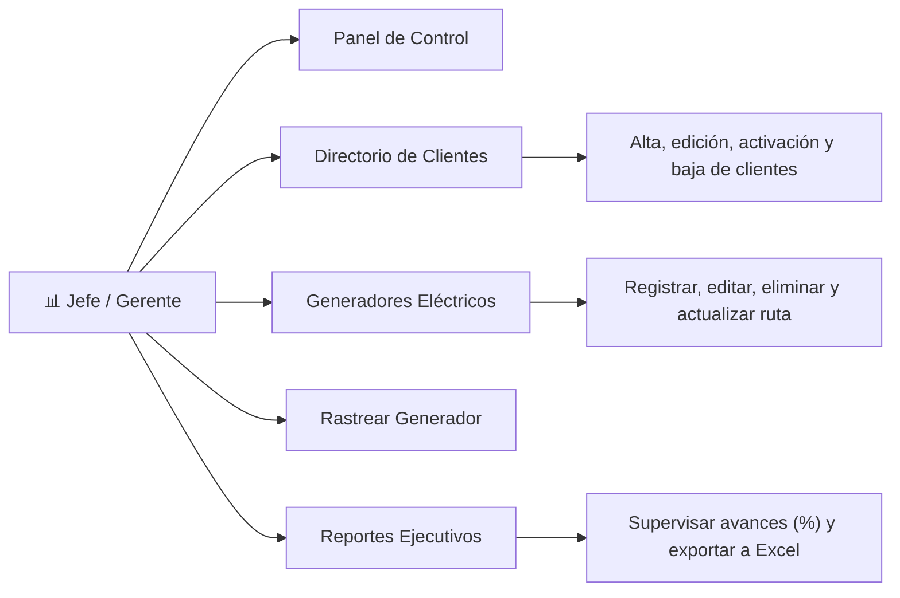

| Caso de Uso (Qué necesita hacer) | Dónde entra | Cómo funciona |
| :--- | :--- | :--- |
| **Supervisar la operación diaria de un vistazo** | Dashboard (Panel de Control) | Revisa cuántos generadores están en fábrica, en barco, en aduana, en almacén o entregados. |
| **Registrar y actualizar fichas de clientes** | Clientes | Crea nuevas empresas compradoras (con envío automático de bienvenida por correo), actualiza teléfonos o desactiva clientes inactivos. |
| **Administrar el catálogo completo de plantas** | Generadores | Registra nuevos equipos, sube su fotografía, edita su fecha estimada de llegada (avisando por correo al cliente) o elimina un equipo. |
| **Reportar avances en las 7 etapas** | Generadores o Rastrear | Registra paradas, puertos o entregas con notas y fecha real del evento; el cliente recibe aviso automático por correo. |
| **Generar informes para gerencia o clientes** | Reportes → Exportar CSV | Filtra por estado o por empresa y descarga el listado listo para abrir en Excel. |
| **Editar su perfil y cambiar su clave** | Mi Perfil | Actualiza su nombre, correo o contraseña personal. |

<strong>🛠️ Empleado / Operador</strong> — <em>Operación Controlada</em>

- **¿Quién usa este perfil?** Personal operativo, de almacén o despacho encargado de cargar equipos y reportar movimientos en ruta.
- **Qué puede hacer:** Tiene las herramientas exactas para el trabajo diario sin riesgo de borrar información sensible por accidente: puede registrar y editar generadores, subir fotos y registrar puntos de control en ruta. En Clientes solo puede consultar información (no puede crear ni borrar), y no tiene acceso a Usuarios ni a Reportes Ejecutivos.
- **Pantallas que ve:** Menú lateral reducido: Dashboard · Rastrear · Generadores · Clientes (Solo consulta) · Mi Perfil

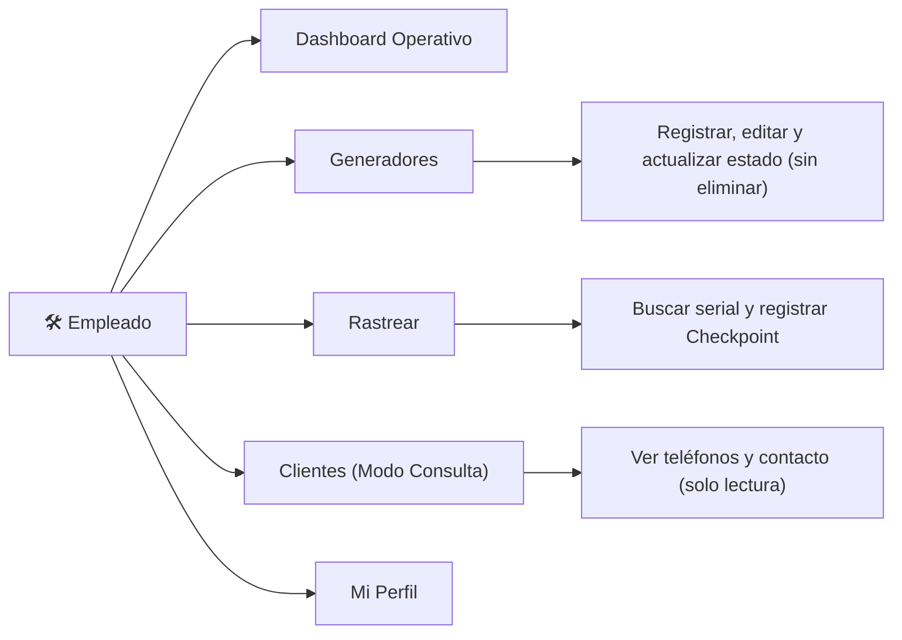

| Caso de Uso (Qué necesita hacer) | Dónde entra | Cómo funciona |
| :--- | :--- | :--- |
| **Registrar la entrada de un nuevo equipo** | Generadores → + Registrar Generador | Carga los datos del generador, su fotografía y el cliente asignado. |
| **Reportar cada parada o cambio de etapa** | Generadores o Rastrear → Registrar Checkpoint | Cambia el estado (por ejemplo, de Aduana Destino a Almacén BaiFa) con observaciones de transporte y notifica al cliente por correo. |
| **Consultar el teléfono o contacto de un cliente** | Clientes (Modo consulta) | Busca la empresa y verifica sus datos de contacto sin riesgo de modificar o borrar la ficha. |
| **Verificar el historial de ruta de un equipo** | Rastrear | Ingresa el serial para revisar todo lo que otros compañeros registraron previamente. |
| **Mantener actualizada su cuenta personal** | Mi Perfil | Edita su nombre, correo o cambia su contraseña. |

<strong>🏢 Cliente Empresarial</strong> — <em>Portal Exclusivo</em>

- **¿Quién usa este perfil?** Empresas compradoras y representantes autorizados que esperan la llegada de sus plantas eléctricas.
- **Qué puede hacer:** Ingresa a un portal privado diseñado únicamente para su empresa: solo ve los generadores asignados a su compañía, nunca los de otros clientes. Puede buscar sus equipos al instante, ver el porcentaje de avance en las 7 etapas, revisar las paradas registradas y mantener al día los datos fiscales de su empresa.
- **Pantallas que ve:** Barra superior exclusiva: Dashboard (Portal) · Rastrear · Mis Generadores · Mi Perfil

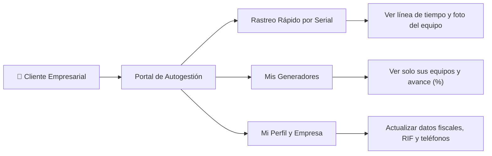

| Caso de Uso (Qué necesita hacer) | Dónde entra | Cómo funciona |
| :--- | :--- | :--- |
| **Solicitar su propia cuenta empresarial** | Pantalla de Inicio → Solicitar acceso | Registra su razón social, RIF, persona de contacto y clave para ingresar de inmediato; recibe correo de bienvenida. |
| **Ver el estado actual de todos sus equipos** | Dashboard (Portal de Autogestión) | Visualiza cuántas unidades están en gestión, cuántas entregadas y una barra de progreso (%) por equipo. |
| **Hacer seguimiento rápido con el serial** | Banner superior → Rastreo rápido por serial | Escribe el código (ej. GEN-2026-0043) y presiona Ir para abrir su historial completo. |
| **Revisar paradas, fechas y fotografía del equipo** | Rastrear o Mis Generadores | Consulta cada paso verificado por BaiFa Power y amplía la foto referencial de su planta. |
| **Recibir avisos automáticos por correo** | Bandeja de correo electrónico | Cada vez que BaiFa avanza un equipo de etapa o edita su fecha estimada de llegada (ETA), recibe un correo con botón directo de rastreo. |
| **Actualizar datos de su empresa y contraseña** | Mi Perfil | Modifica razón social, nombre comercial, RIF, teléfonos de oficina/móvil o clave de ingreso. |

<strong>🌐 Visitante Público (Invitado)</strong> — <em>Sin Contraseña</em>

- **¿Quién usa este perfil?** Cualquier persona externa (chofer, receptor en obra, inspector o interesado) que posea el número de serial de un equipo.
- **Qué puede hacer:** Puede consultar en línea el estado logístico y la línea de tiempo de cualquier generador con solo escribir su serial, sin necesidad de iniciar sesión. Por seguridad y confidencialidad, la plataforma oculta automáticamente quién es la empresa compradora, su RIF y los nombres internos del personal.
- **Pantallas que ve:** Página pública de Rastreo (sin barra lateral ni menú privado)

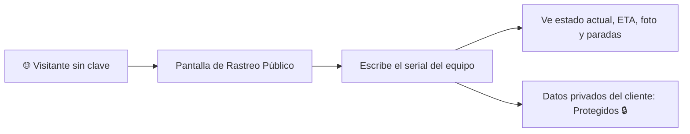

| Caso de Uso (Qué necesita hacer) | Dónde entra | Cómo funciona |
| :--- | :--- | :--- |
| **Consultar dónde va un generador sin clave** | Página de Rastreo → Buscar por serial | Escribe el serial (ej. GEN-2026-0041) y presiona Buscar. |
| **Verificar fecha estimada de llegada y foto** | Ficha resumen del equipo | Consulta el estado actual, potencia en kVA, ETA y la fotografía referencial. |
| **Revisar las paradas ya confirmadas** | Historial de Tránsito | Observa los puntos de control verificados por BaiFa Power Logistics con privacidad garantizada. |
| **Iniciar sesión si ya posee cuenta** | Botón Iniciar Sesión (arriba a la derecha) | Accede con su correo y clave para ver información completa si pertenece a la empresa o al equipo. |

---

## 🚢 Las 7 Etapas del Recorrido de un Generador

Desde que se aprueba la orden de compra hasta que la planta eléctrica llega a las instalaciones del cliente, el equipo de BaiFa actualiza manualmente su avance por estas **7 etapas oficiales**:

| Paso | Etapa en el Sistema | Qué significa en la práctica |
| :---: | :--- | :--- |
| **1** | **Orden de Compra** | El pedido fue aprobado y confirmado formalmente con fábrica. |
| **2** | **En Producción** | El generador se encuentra en ensamblaje y pruebas de fábrica. |
| **3** | **En Aduana de Origen** | La unidad está cumpliendo trámites de exportación en el puerto de salida. |
| **4** | **En Tránsito Marítimo** | El equipo ya zarpó en buque de carga rumbo al puerto de destino. |
| **5** | **En Aduana Destino** | El generador llegó a puerto nacional y está en proceso de nacionalización. |
| **6** | **En Almacén BaiFa** | Equipo verificado, inspeccionado y resguardado en almacén central BaiFa. |
| **7** | **Entregado** | Generador entregado formalmente en las instalaciones del cliente. |

> ✉️ **Aviso automático al cliente:** Cada vez que el personal de BaiFa actualiza un generador a una nueva etapa o modifica su ficha, el sistema envía automáticamente un correo electrónico al cliente asignado informándole la novedad.

---

## 📖 Guía Detallada Módulo por Módulo

### Módulo 1 · Acceso, Registro y Recuperación de Cuenta
**¿Quién lo usa?** Todos los usuarios y nuevos clientes

Es la puerta de entrada a BaiFa Power Tracking. Permite ingresar con tu correo y contraseña, registrar una nueva empresa cliente desde cero o recuperar el acceso si olvidaste tu clave.

#### 1.1. Iniciar Sesión
Al abrir la plataforma verás la pantalla de ingreso. Escribe tu correo y contraseña para entrar automáticamente a la vista que corresponde a tu cargo.

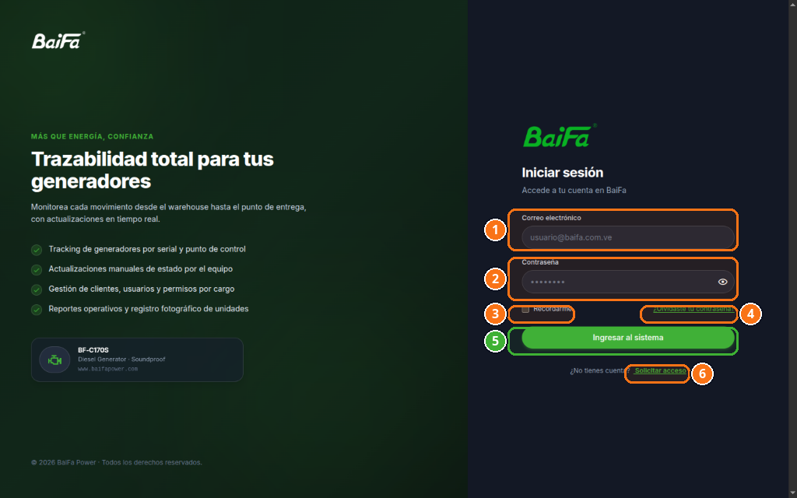

| N.º | Elemento / Acción señalada | Qué hace |
| :---: | :--- | :--- |
| **1** | **Correo electrónico** | Escribe el correo con el que fuiste registrado (ejemplo: usuario@empresa.com). |
| **2** | **Contraseña y botón de ojo** | Ingresa tu clave secreta. Haz clic en el ícono del ojo a la derecha si deseas ver lo que estás escribiendo. |
| **3** | **Recordarme** | Marca esta casilla si usas tu computadora personal y quieres mantener tu acceso cómodo. |
| **4** | **¿Olvidaste tu contraseña?** | Haz clic aquí si no recuerdas tu clave para recibir un enlace de recuperación en tu correo. |
| **5** | **Ingresar al sistema** | Presiona este botón verde para entrar a tu panel de trabajo o portal. |
| **6** | **Solicitar acceso** | Si eres un cliente nuevo y aún no tienes cuenta, haz clic aquí para registrar tu empresa. |

#### 1.2. Solicitar Acceso (Registro de Nueva Empresa Cliente)
Cualquier empresa compradora nueva puede crear su propia cuenta de cliente completando sus datos fiscales y de contacto. El sistema formatea automáticamente el RIF y los teléfonos mientras escribes.

> ✉️ **Dispara correo automático: Al finalizar el registro, la empresa recibe el correo '¡Bienvenido a BaiFa! - Registro de Cliente Exitoso' con el resumen de su ficha fiscal y un botón directo para acceder a su portal (ver detalle en el Módulo 10).**

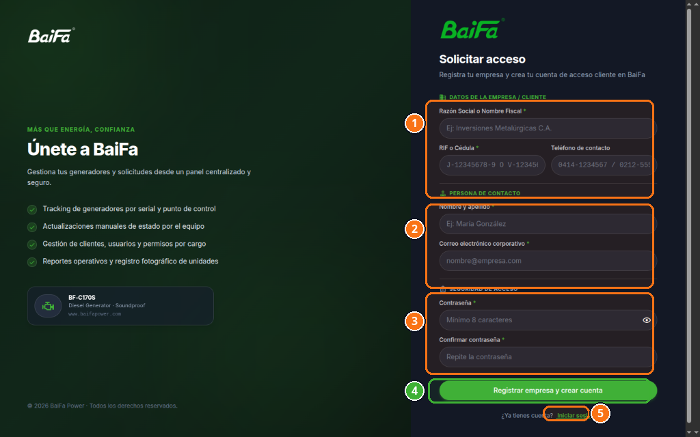

| N.º | Elemento / Acción señalada | Qué hace |
| :---: | :--- | :--- |
| **1** | **Datos de la Empresa / Cliente** | Ingresa la Razón Social legal, el RIF o Cédula (ej. J-12345678-9) y el teléfono de contacto. |
| **2** | **Persona de Contacto** | Escribe el nombre y apellido del representante y su correo corporativo (este correo será su usuario de acceso). |
| **3** | **Seguridad de Acceso** | Crea una contraseña de al menos 8 caracteres y repítela exactamente igual para confirmarla. |
| **4** | **Registrar empresa y crear cuenta** | Presiona este botón verde para finalizar. Verás una confirmación y ya podrás iniciar sesión. |
| **5** | **Iniciar sesión** | Si ya habías creado tu cuenta anteriormente, vuelve directo a la pantalla de acceso. |

#### 1.3. Recuperar Contraseña Olvidada
Si olvidaste tu contraseña, no necesitas pedir ayuda manual: puedes solicitar un enlace seguro directamente a tu correo electrónico.

> ✉️ **Dispara correo automático: Al presionar 'Enviar enlace de recuperación', el usuario recibe el correo 'Restablece tu contraseña - Baifa' con el botón 'Restablecer mi contraseña' (válido por 60 minutos) y un enlace alternativo de respaldo (ver captura en el Módulo 10).**

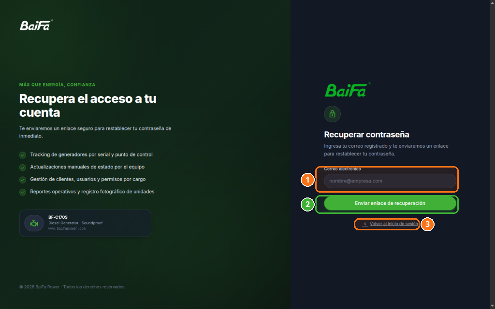

| N.º | Elemento / Acción señalada | Qué hace |
| :---: | :--- | :--- |
| **1** | **Correo electrónico registrado** | Escribe el correo con el que ingresas normalmente a BaiFa. |
| **2** | **Enviar enlace de recuperación** | Presiona este botón verde. El sistema enviará un correo con un enlace temporal seguro. |
| **3** | **Volver al inicio de sesión** | Regresa a la pantalla principal para entrar una vez hayas cambiado tu clave. |

#### 1.4. Crear Nueva Contraseña (desde el enlace del correo)
Al hacer clic en el botón o enlace que llegó a tu bandeja de entrada, se abrirá esta pantalla para elegir tu nueva clave.

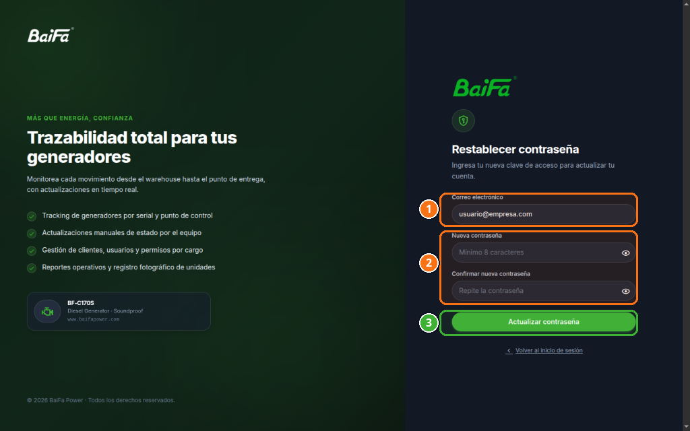

| N.º | Elemento / Acción señalada | Qué hace |
| :---: | :--- | :--- |
| **1** | **Correo electrónico** | Confirma que corresponde a tu dirección de correo registrada (se llena automáticamente desde el enlace). |
| **2** | **Nueva contraseña y confirmación** | Escribe tu nueva clave (mínimo 8 caracteres) y repítela en el segundo campo. |
| **3** | **Actualizar contraseña** | Presiona este botón verde para guardar tu nueva clave. De inmediato podrás iniciar sesión. |

---

### Módulo 2 · Panel de Control Principal (Dashboard Operativo)
**¿Quién lo usa?** Superadministrador · Jefe / Gerente · Empleado

Es la primera pantalla que ve el equipo interno al iniciar sesión. Resume en pocos segundos cuántos generadores existen en cada etapa, los movimientos más recientes y permite navegar por toda la plataforma.

#### Vista General del Panel de Control
Desde aquí no tienes que buscar en tablas largas para saber cómo está la operación del día: todo aparece resumido en tarjetas y una línea de flujo.

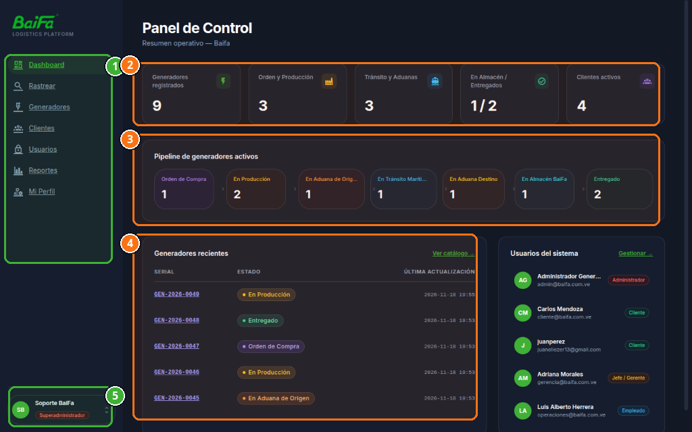

| N.º | Elemento / Acción señalada | Qué hace |
| :---: | :--- | :--- |
| **1** | **Menú lateral de navegación** | Te permite saltar entre módulos. Solo verás las secciones autorizadas para tu cargo (por ejemplo, Empleados no ven Usuarios ni Reportes). |
| **2** | **Tarjetas de resumen rápido** | Muestran el total de generadores, cuántos están en orden/producción, cuántos en tránsito y aduanas, en almacén/entregados y clientes activos. |
| **3** | **Pipeline de generadores activos** | Representa visualmente las 7 etapas logísticas de izquierda a derecha con la cantidad exacta de equipos en cada fase. |
| **4** | **Generadores recientes** | Lista los últimos equipos actualizados. Si haces clic sobre cualquier serial azul (ej. GEN-2026-0049), irás directo a su rastreo completo. |
| **5** | **Tu cuenta y menú de salida** | Haz clic sobre tu nombre en la esquina inferior izquierda para abrir el acceso rápido a Mi Perfil o Cerrar sesión de forma segura. |

---

### Módulo 3 · Catálogo de Generadores y Puntos de Control
**¿Quién lo usa?** Superadministrador · Jefe / Gerente · Empleado (Cliente ve solo los suyos en lectura)

Es el corazón operativo del sistema. Aquí se registran las plantas eléctricas que llegan o salen, se vinculan a su empresa compradora, se sube su fotografía y se actualiza manualmente cada avance de ruta.

#### 3.1. Listado, Contadores y Filtros de Generadores
Muestra todo el inventario de equipos con indicadores por estado, buscador instantáneo y botones de acción directa en cada fila.

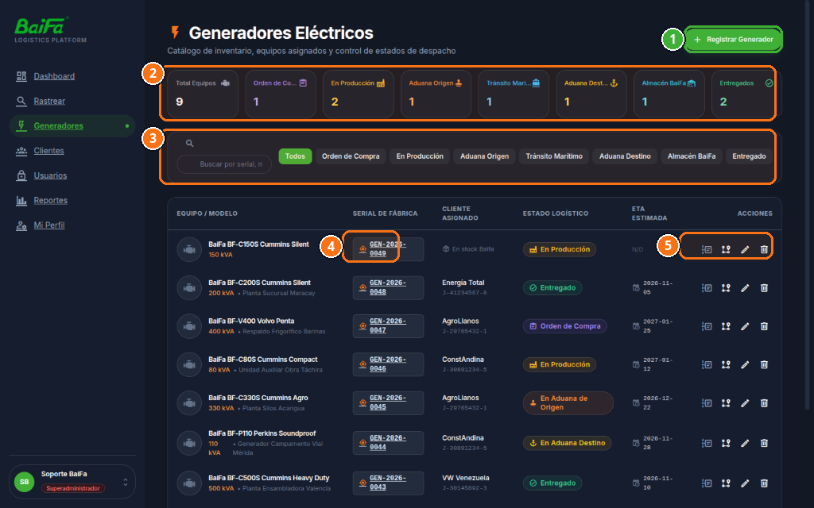

| N.º | Elemento / Acción señalada | Qué hace |
| :---: | :--- | :--- |
| **1** | **+ Registrar Generador** | Botón verde (arriba a la derecha) para dar de alta una nueva planta eléctrica en el catálogo. |
| **2** | **Contadores por etapa** | Ocho tarjetas superiores con el Total de Equipos y el conteo exacto en cada una de las 7 etapas logísticas. |
| **3** | **Buscador y filtros rápidos** | Escribe un serial, modelo o nombre de cliente, o presiona cualquiera de los botones de estado (Orden de Compra, En Producción, etc.) para filtrar la tabla al instante. |
| **4** | **Serial de fábrica interactivo** | Al hacer clic en el serial de un equipo se abre automáticamente su pantalla de Rastreo y línea de tiempo. |
| **5** | **Botones de acción por equipo** | De izquierda a derecha: (a) Ver historial de ruta, (b) Actualizar estado / Registrar punto de control, (c) Editar ficha del generador y (d) Eliminar equipo (este ícono de papelera solo aparece para Administradores y Gerentes). |

#### 3.2. Registrar o Editar un Generador
Al presionar '+ Registrar Generador' (o el lápiz de editar), se abre esta ventana para completar o modificar la ficha del equipo.

> ✉️ **Dispara correo automático al editar: Si modificas la fecha estimada de llegada (ETA), modelo, notas, estado o cliente de un generador ya asignado a una empresa, el sistema envía automáticamente al cliente el correo 'Actualización de Información / Cambio de Estatus' comparando el dato anterior con el nuevo.**

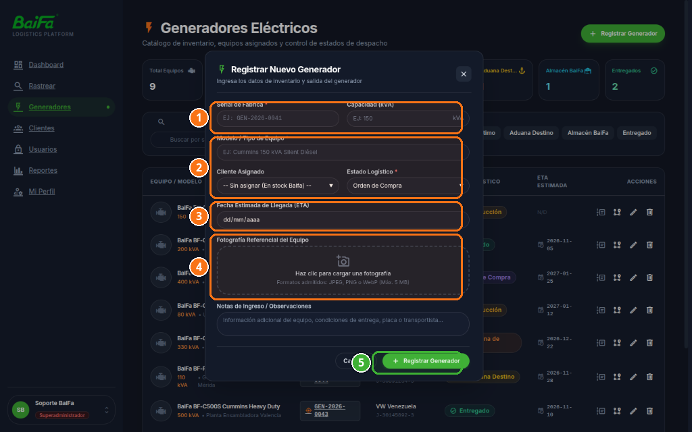

| N.º | Elemento / Acción señalada | Qué hace |
| :---: | :--- | :--- |
| **1** | **Serial de Fábrica y Capacidad (kVA)** | Escribe el código único del generador (ej. GEN-2026-0041) y su potencia eléctrica en kVA. |
| **2** | **Modelo, Cliente Asignado y Estado** | Indica el modelo del equipo, selecciona la empresa cliente (o déjalo 'En stock BaiFa') y elige su etapa logística inicial. |
| **3** | **Fecha Estimada de Llegada (ETA)** | Selecciona en el calendario cuándo se prevé entregar o recibir el generador. |
| **4** | **Fotografía Referencial del Equipo** | Haz clic en el recuadro punteado para subir una imagen real del equipo (JPEG, PNG o WebP hasta 5 MB) con vista previa inmediata. |
| **5** | **Guardar registro** | Agrega notas opcionales abajo y presiona '+ Registrar Generador' para incorporarlo al catálogo. |

#### 3.3. Actualizar Estado y Registrar Punto de Control
BaiFa opera con actualización manual verificada por su equipo. Cada vez que un generador avanza de fase o llega a un punto de control, se registra aquí.

> ✉️ **Dispara correo automático de avance en ruta: Al guardar el punto de control, si el generador pertenece a un cliente, el sistema envía de inmediato al correo de contacto de la empresa (y con copia al usuario del portal si es otro correo) la notificación con la nueva etapa, ubicación, fecha, observaciones y el botón 'Rastrear Generador en Tiempo Real'.**

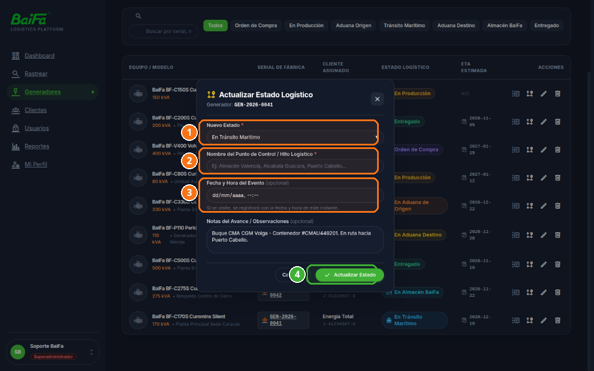

| N.º | Elemento / Acción señalada | Qué hace |
| :---: | :--- | :--- |
| **1** | **Nuevo Estado** | Despliega la lista y elige la nueva etapa alcanzada (por ejemplo: En Aduana Destino, En Almacén BaiFa o Entregado). |
| **2** | **Nombre del Punto de Control / Hito** | Escribe dónde ocurrió el movimiento (ej. 'Puerto Cabello', 'Almacén Valencia' o 'Sede Cliente Caracas'). |
| **3** | **Fecha y Hora del Evento (opcional)** | Si el movimiento ocurrió antes, puedes indicar la fecha y hora exacta; si lo dejas vacío, se registra la hora actual. |
| **4** | **Notas y botón Actualizar Estado** | Anota detalles útiles (buque, placa de camión, chofer, observaciones) y presiona 'Actualizar Estado' para certificar el movimiento en la bitácora. |

---

### Módulo 4 · Rastreo de Equipos e Historial de Ruta
**¿Quién lo usa?** Todos los usuarios registrados y Visitantes Públicos

Permite consultar la historia completa de un generador de principio a fin, como una guía de encomienda: muestra su estado actual, fecha estimada de llegada, fotografía y cada parada certificada en orden cronológico.

#### 4.1. Rastreo Detallado (Equipo Interno y Cliente dueño del equipo)
Muestra toda la información operativa del equipo y su línea de tiempo inmutable (los registros pasados quedan certificados con nombre del responsable y fecha para máxima transparencia).

> ✉️ **Dispara correo automático desde aquí: Si un Administrador, Gerente o Empleado usa el botón verde 'Registrar Checkpoint' desde esta pantalla, también se envía automáticamente el correo de aviso al cliente asignado con el enlace directo a este rastreo.**

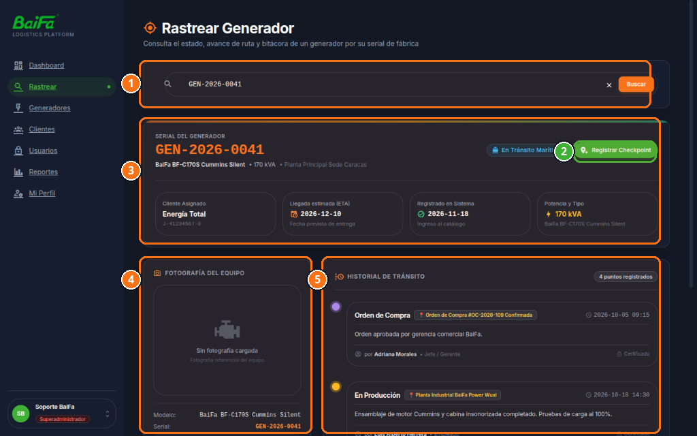

| N.º | Elemento / Acción señalada | Qué hace |
| :---: | :--- | :--- |
| **1** | **Barra de búsqueda por serial** | Ingresa o pega el serial del generador (ej. GEN-2026-0041) y presiona el botón naranja 'Buscar'. |
| **2** | **Botón Registrar Checkpoint** | Disponible únicamente para el equipo interno (Admin, Gerente, Empleado) para añadir una nueva parada sin salir de esta pantalla. |
| **3** | **Ficha resumen del generador** | Muestra el serial en grande, su estado actual, la empresa cliente asignada con su RIF, la llegada estimada (ETA), fecha de registro y potencia (kVA). |
| **4** | **Fotografía del Equipo** | Muestra la imagen cargada del generador (puedes hacer clic sobre ella para ampliarla en pantalla completa) junto a su modelo y observaciones. |
| **5** | **Historial de Tránsito (Línea de Tiempo)** | Lista cronológica de todas las paradas registradas, con notas, fecha/hora exacta, quién realizó el registro y sello de 'Certificado'. |

#### 4.2. Consulta Pública de Rastreo (Sin Iniciar Sesión)
Si alguien abre el módulo de Rastreo sin haber iniciado sesión (o si un cliente busca un serial que no pertenece a su empresa), el sistema activa el Modo Consulta Pública para proteger la privacidad comercial.

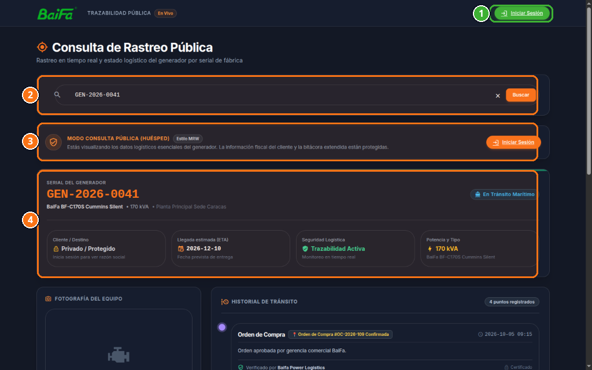

| N.º | Elemento / Acción señalada | Qué hace |
| :---: | :--- | :--- |
| **1** | **Botón Iniciar Sesión** | Permite a usuarios registrados ingresar rápidamente con su cuenta desde la barra superior. |
| **2** | **Buscador abierto al público** | Cualquier persona con el número de serial puede consultar el estatus de la planta sin necesitar usuario ni clave. |
| **3** | **Aviso de Modo Consulta Pública** | Informa claramente que la vista muestra solo los datos logísticos esenciales y que la información fiscal del cliente está protegida. |
| **4** | **Datos privados ocultos** | El recuadro 'Cliente / Destino' aparece como 'Privado / Protegido', cuidando la identidad de tus clientes frente a terceros. |

---

### Módulo 5 · Directorio de Clientes
**¿Quién lo usa?** Superadministrador y Jefe / Gerente (gestión completa) · Empleado (solo consulta)

Centraliza la ficha fiscal y los datos de contacto de todas las empresas compradoras, vinculando automáticamente cada empresa con su cuenta de usuario para el Portal de Clientes.

#### 5.1. Directorio de Clientes (Administrador y Gerente)
Permite consultar, crear, editar, suspender temporalmente o eliminar empresas registradas en la cartera de BaiFa.

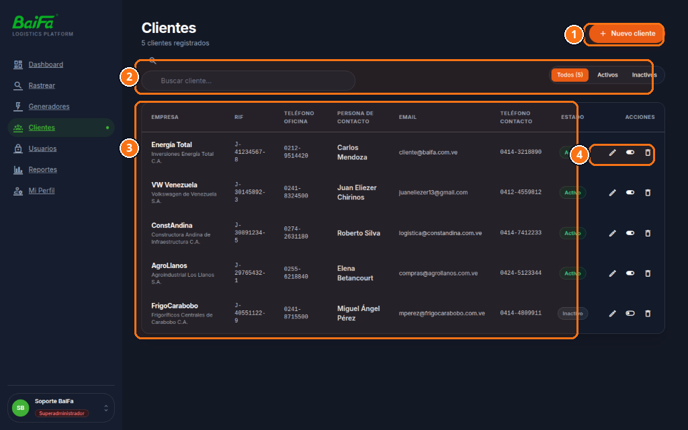

| N.º | Elemento / Acción señalada | Qué hace |
| :---: | :--- | :--- |
| **1** | **+ Nuevo cliente** | Botón naranja para registrar una nueva empresa en el directorio. |
| **2** | **Buscador y filtro Activos / Inactivos** | Busca por nombre comercial, razón social, RIF o correo, o filtra entre Todos, Activos e Inactivos. |
| **3** | **Tabla de directorio fiscal** | Presenta empresa, RIF, teléfono de oficina, persona de contacto, correo electrónico, teléfono directo y estado. |
| **4** | **Acciones por cliente** | De izquierda a derecha: (a) Lápiz para editar la ficha fiscal, (b) Interruptor para activar o desactivar el acceso de la empresa y su usuario, y (c) Papelera para eliminar. |

#### 5.2. Ventana de Registro de Nuevo Cliente
Al crear una empresa desde aquí, el sistema valida el formato del RIF y teléfonos y además genera automáticamente su usuario de acceso con perfil Cliente.

> ✉️ **Dispara correo automático de bienvenida: Al presionar 'Crear cliente', la persona de contacto recibe el correo '¡Bienvenido a BaiFa! - Registro de Cliente Exitoso' con los datos fiscales de su empresa, su contraseña inicial provisional, la recomendación de cambiarla y el botón 'Acceder a mi Portal'.**

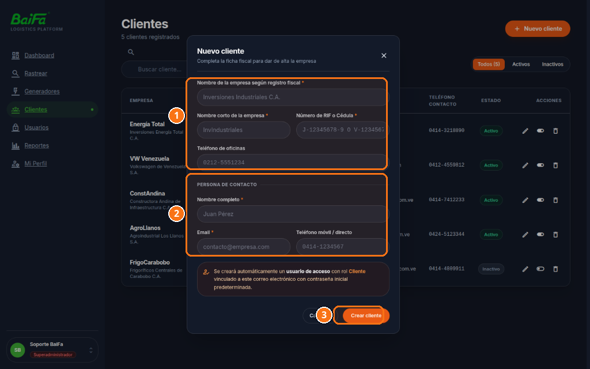

| N.º | Elemento / Acción señalada | Qué hace |
| :---: | :--- | :--- |
| **1** | **Ficha Fiscal de la Empresa** | Completa la Razón Social legal, el Nombre corto comercial, el RIF o Cédula (ej. J-12345678-9) y teléfono de oficinas. |
| **2** | **Persona de Contacto** | Ingresa el nombre completo, correo electrónico y teléfono móvil del responsable en la empresa cliente. |
| **3** | **Creación automática de acceso** | El aviso inferior confirma que se creará automáticamente una cuenta de acceso Cliente vinculada a ese correo al presionar 'Crear cliente'. |

#### 5.3. Modo Solo Consulta para Empleados
Cuando un usuario con cargo Empleado entra a Clientes, puede buscar teléfonos y correos de contacto para coordinar entregas, pero el sistema protege la base de clientes impidiendo modificaciones.

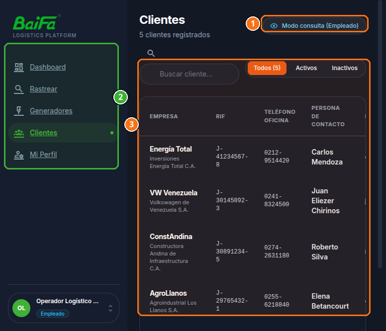

| N.º | Elemento / Acción señalada | Qué hace |
| :---: | :--- | :--- |
| **1** | **Indicador 'Modo consulta (Empleado)'** | Confirma visualmente que la vista es de solo lectura; el botón '+ Nuevo cliente' no aparece. |
| **2** | **Menú lateral adaptado** | El empleado ve únicamente los módulos operativos permitidos (sin Usuarios ni Reportes). |
| **3** | **Búsqueda y lectura segura** | Puede buscar clientes y ver sus teléfonos o correos, pero la columna de acciones muestra 'Solo consulta' sin botones de editar ni borrar. |

---

### Módulo 6 · Gestión de Usuarios del Sistema
**¿Quién lo usa?** Exclusivo Superadministrador

Permite al administrador principal crear las cuentas de su equipo interno (administradores, gerentes y empleados), revisar todos los usuarios registrados, cambiar roles o suspender accesos al instante.

#### 6.1. Listado y Control de Usuarios
Muestra todas las personas con acceso a la plataforma, su cargo actual, si su cuenta está activa y desde cuándo están registradas.

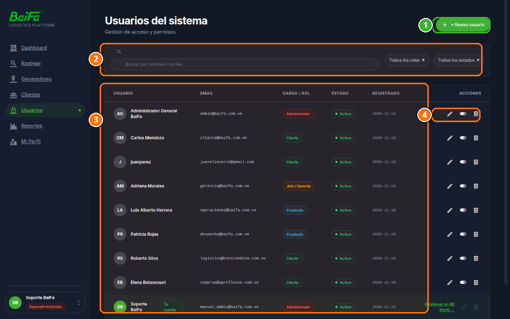

| N.º | Elemento / Acción señalada | Qué hace |
| :---: | :--- | :--- |
| **1** | **+ Nuevo usuario** | Botón verde para crear una nueva cuenta para personal interno de BaiFa. |
| **2** | **Buscador y filtros por Rol / Estado** | Encuentra rápidamente a cualquier persona por nombre o correo, o filtra por cargo (Administrador, Jefe/Gerente, Empleado, Cliente) y estado. |
| **3** | **Tabla de cuentas registradas** | Muestra nombre, iniciales, correo, etiqueta de color del cargo, estado (Activo/Inactivo) y fecha de registro. |
| **4** | **Acciones y protección de cuenta propia** | Permite editar datos/cargo, activar/desactivar acceso o eliminar terceros. Sobre tu propia cuenta ('Tu cuenta'), el botón de eliminar está bloqueado y te ofrece el enlace directo 'Gestionar en Mi Perfil'. |

#### 6.2. Crear un Nuevo Usuario Interno
Al crear una cuenta, la ventana te explica con palabras claras qué podrá y qué no podrá hacer la persona según el cargo que selecciones.

> ✉️ **Dispara correo automático con credenciales: Al presionar 'Crear usuario', la persona recibe el correo 'Tu cuenta en BaiFa ha sido creada exitosamente' con su nombre, correo, cargo asignado, contraseña inicial, recomendación de seguridad y el botón 'Iniciar Sesión en BaiFa'.**

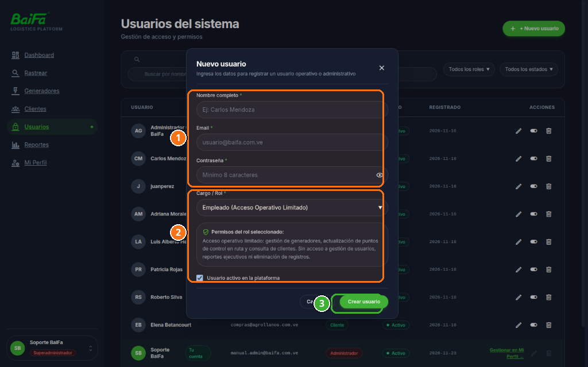

| N.º | Elemento / Acción señalada | Qué hace |
| :---: | :--- | :--- |
| **1** | **Datos personales y clave inicial** | Escribe el nombre completo, correo corporativo y contraseña inicial (mínimo 8 caracteres). |
| **2** | **Cargo / Rol y resumen de permisos** | Elige entre Administrador, Jefe / Gerente o Empleado. Debajo aparecerá un recuadro explicando exactamente los permisos de ese cargo. |
| **3** | **Estado activo y Crear usuario** | Deja marcada la casilla 'Usuario activo en la plataforma' y presiona 'Crear usuario'. |

---

### Módulo 7 · Portal Exclusivo para Clientes
**¿Quién lo usa?** Cliente Empresarial

Es el espacio privado que ve el cliente cuando inicia sesión. Tiene una navegación superior limpia, sin opciones administrativas, centrada únicamente en sus plantas eléctricas.

#### Portal de Autogestión del Cliente
Apenas inicia sesión, el cliente recibe un saludo personalizado con el nombre y RIF de su empresa y accede de inmediato a sus equipos.

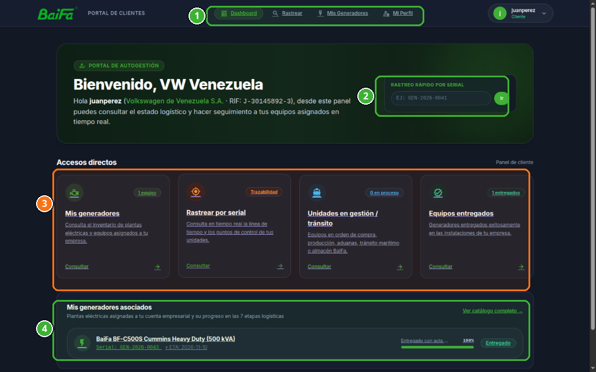

| N.º | Elemento / Acción señalada | Qué hace |
| :---: | :--- | :--- |
| **1** | **Barra superior exclusiva** | Cuatro accesos simples: Dashboard (inicio), Rastrear, Mis Generadores y Mi Perfil, más el menú con su nombre a la derecha. |
| **2** | **Rastreo rápido por serial** | Permite escribir el serial de un equipo y presionar 'Ir' para saltar directamente a su línea de tiempo. |
| **3** | **4 Tarjetas de acceso directo** | Resumen visual de sus generadores totales, acceso a rastreo, cantidad de unidades en gestión/tránsito y equipos ya entregados. |
| **4** | **Mis generadores asociados** | Lista cada planta de su empresa con modelo, potencia (kVA), serial, fecha estimada de llegada, etiqueta de estado y una barra verde con el porcentaje de avance en las 7 etapas. Hacer clic en la tarjeta abre su detalle de rastreo. |

---

### Módulo 8 · Tablero de Reportes Ejecutivos
**¿Quién lo usa?** Superadministrador · Jefe / Gerente

Ofrece una visión gerencial completa para analizar la flota de generadores, la cartera de clientes y los usuarios del sistema, con filtros combinados y descarga instantánea para Microsoft Excel.

#### Reportes y Exportación compatible con Excel
Pensado para juntas directivas y control gerencial: muestra porcentajes reales, separa los equipos en proceso de los ya entregados y permite descargar cualquier vista filtrada.

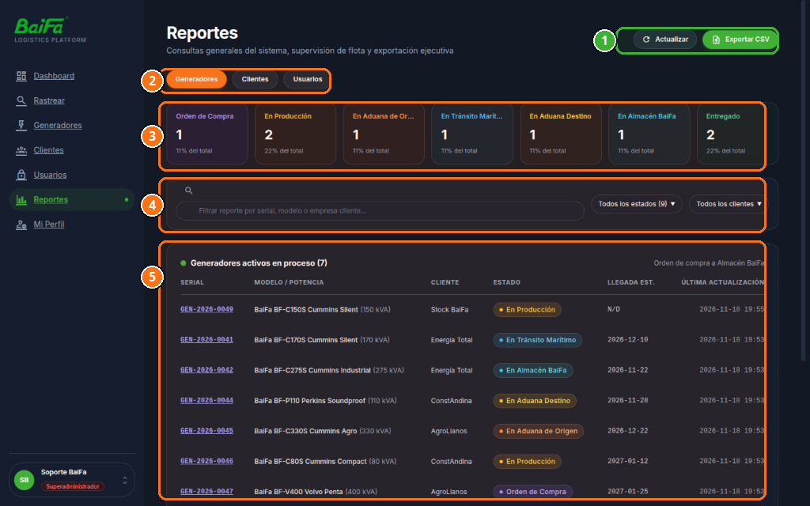

| N.º | Elemento / Acción señalada | Qué hace |
| :---: | :--- | :--- |
| **1** | **Actualizar y Exportar CSV** | El botón 'Actualizar' recarga los datos en vivo; el botón verde 'Exportar CSV' descarga la pestaña y filtros actuales en un archivo listo para abrir en Excel con tildes y formato limpio. |
| **2** | **Pestañas de reporte** | Alterna entre los reportes consolidados de Generadores, Clientes y Usuarios. |
| **3** | **7 Tarjetas interactivas con porcentaje** | Muestran cantidad y porcentaje del total por cada etapa logística. Si haces clic sobre cualquiera de estas 7 tarjetas, la tabla inferior se filtra automáticamente por ese estado. |
| **4** | **Filtros combinados** | Busca por texto o filtra por estado específico y empresa cliente al mismo tiempo. |
| **5** | **Tablas divididas (En proceso vs. Entregados)** | Organiza primero los equipos activos en curso (de Orden de Compra a Almacén BaiFa) y debajo los ya entregados; haciendo clic en cualquier serial puedes inspeccionar su ruta. |

---

### Módulo 9 · Mi Perfil y Seguridad Personal
**¿Quién lo usa?** Todos los usuarios autenticados (Administrador, Gerente, Empleado y Cliente)

Cada usuario tiene su propio espacio para revisar qué permisos tiene su cargo, mantener al día su nombre o correo y cambiar su contraseña de forma segura sin depender de nadie.

#### 9.1. Mi Perfil para Personal Interno (Admin, Gerente, Empleado)
Muestra tu tarjeta de identidad, un resumen claro de lo que puedes hacer en la plataforma y dos formularios independientes: datos personales y cambio de contraseña.

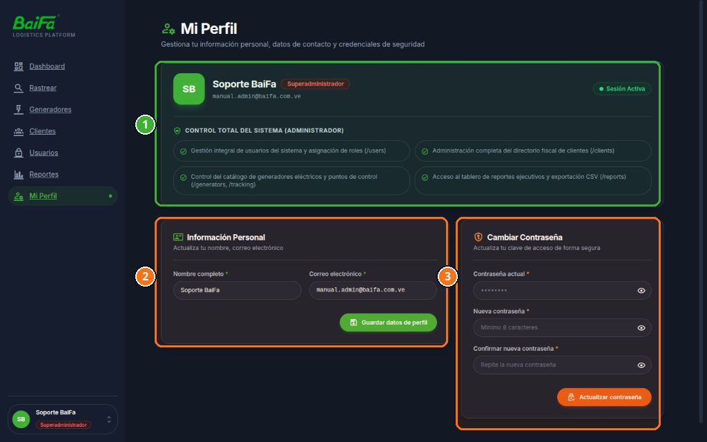

| N.º | Elemento / Acción señalada | Qué hace |
| :---: | :--- | :--- |
| **1** | **Tarjeta de identidad y permisos del cargo** | Muestra tus iniciales, nombre, correo, etiqueta de rol, estado 'Sesión Activa' y las 4 capacidades principales de tu perfil. |
| **2** | **Información Personal** | Permite actualizar tu Nombre completo o Correo electrónico y guardar con el botón verde 'Guardar datos de perfil'. |
| **3** | **Cambiar Contraseña** | Para mayor seguridad exige escribir primero tu contraseña actual, luego la nueva (mínimo 8 caracteres) y confirmarla antes de presionar 'Actualizar contraseña'. |

#### 9.2. Mi Perfil para Cliente Empresarial (Incluye Ficha Fiscal de Empresa)
Además de sus datos personales y cambio de clave, el usuario Cliente puede actualizar directamente la ficha fiscal y teléfonos de su propia empresa.

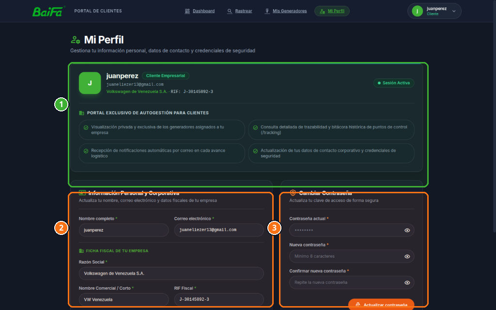

| N.º | Elemento / Acción señalada | Qué hace |
| :---: | :--- | :--- |
| **1** | **Resumen del Portal de Autogestión** | Muestra el nombre de la empresa vinculada, su RIF y los alcances exclusivos de su portal. |
| **2** | **Información Personal y Ficha Fiscal de tu Empresa** | Permite editar tanto el nombre/correo del contacto como la Razón Social, Nombre Comercial, RIF, Teléfono de Oficina y Teléfono Móvil de la empresa. |
| **3** | **Cambiar Contraseña** | Sección independiente para renovar la clave de acceso del portal cuando el cliente lo desee. |

---

### Módulo 10 · Notificaciones Automáticas por Correo Electrónico
**¿Quién lo usa?** Clientes Empresariales y Personal Interno según cada proceso

Para que nadie tenga que estar revisando la plataforma a cada hora, BaiFa Power Tracking envía automáticamente correos institucionales cada vez que ocurre un evento importante. A continuación ves exactamente cómo llegan a la bandeja de entrada y qué botones o acciones ofrece cada mensaje.

| Proceso que lo dispara | Asunto del correo | Quién lo recibe | Opciones dentro del correo |
| :--- | :--- | :--- | :--- |
| **Registro de nuevo cliente (desde 'Solicitar acceso' o desde Clientes → + Nuevo cliente)** | ¡Bienvenido a BaiFa! - Registro de Cliente Exitoso | El contacto principal de la empresa cliente | Confirmar sus datos fiscales y presionar 'Acceder a mi Portal' (y ver su clave inicial si lo creó BaiFa). |
| **Solicitud de recuperación de clave (desde '¿Olvidaste tu contraseña?')** | Restablece tu contraseña - Baifa | El usuario que olvidó su clave | Presionar 'Restablecer mi contraseña' (válido por 60 min) o copiar el enlace alternativo. |
| **Creación de cuenta interna (desde Usuarios → + Nuevo usuario)** | Tu cuenta en BaiFa ha sido creada exitosamente | El nuevo Administrador, Gerente o Empleado | Consultar su rol asignado y clave inicial, y presionar 'Iniciar Sesión en BaiFa'. |
| **Nuevo punto de control o cambio de etapa (Generadores o Rastrear → Registrar Checkpoint)** | [BaiFa Tracking] ... Generador #SERIAL - Punto | El correo de contacto del cliente asignado (con copia a su usuario si difiere) | Ver la ubicación, estatus, fecha/hora y notas, y presionar 'Rastrear Generador en Tiempo Real'. |
| **Edición de datos del generador (Generadores → Editar ficha)** | [BaiFa Tracking] Actualización de Información / Cambio de Estatus | El correo de contacto del cliente asignado (con copia a su usuario si difiere) | Comparar qué dato cambió (valor anterior vs. nuevo) y presionar 'Consultar en el Portal'. |

#### 10.1. Correo de Bienvenida a Nuevo Cliente (Registro o Alta en Directorio)
Se envía automáticamente cuando una empresa se registra desde 'Solicitar acceso' o cuando un Administrador/Gerente la crea en el Directorio de Clientes. Si lo creó el equipo interno de BaiFa, el correo incluye su contraseña inicial provisional.

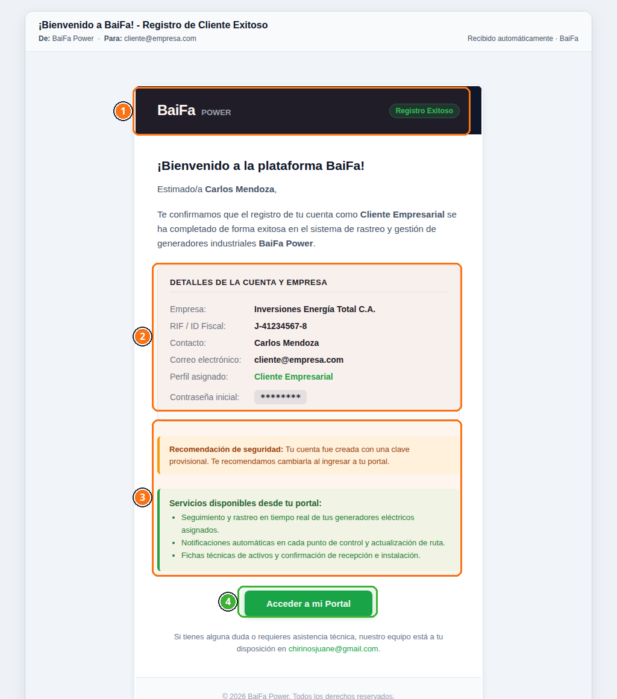

| N.º | Elemento / Acción señalada | Qué hace |
| :---: | :--- | :--- |
| **1** | **Encabezado oficial y confirmación** | Identifica al remitente oficial BaiFa Power y confirma que el registro como Cliente Empresarial fue exitoso. |
| **2** | **Detalles de la cuenta y empresa** | Resume Razón Social, RIF, nombre del contacto, correo de ingreso, perfil asignado y la contraseña inicial (cuando la cuenta es creada por un Administrador o Gerente). |
| **3** | **Recomendación de seguridad y servicios** | Recuerda cambiar la clave provisional al entrar y enumera lo que el cliente puede hacer desde su portal. |
| **4** | **Botón 'Acceder a mi Portal' y contacto de ayuda** | Lleva con un clic a la pantalla de inicio de sesión; debajo muestra el correo de asistencia técnica por si el cliente necesita soporte. |

#### 10.2. Correo de Recuperación de Contraseña
Se envía cuando cualquier usuario hace clic en '¿Olvidaste tu contraseña?' e ingresa su correo electrónico en el Módulo 1.3.

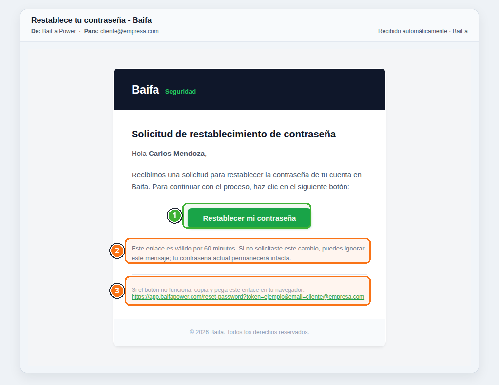

| N.º | Elemento / Acción señalada | Qué hace |
| :---: | :--- | :--- |
| **1** | **Botón verde 'Restablecer mi contraseña'** | Abre directamente la pantalla segura para elegir la nueva contraseña sin volver a pedir el correo. |
| **2** | **Vigencia de seguridad (60 minutos)** | Explica que el enlace caduca en 60 minutos y que, si la persona no pidió el cambio, puede ignorar el mensaje sin riesgo. |
| **3** | **Enlace completo de respaldo** | Si el programa de correo bloquea el botón, permite copiar y pegar directamente el enlace completo en el navegador. |

#### 10.3. Correo de Bienvenida para Nuevo Usuario Interno
Se envía automáticamente cuando el Superadministrador crea una nueva cuenta desde Usuarios → + Nuevo usuario (Administrador, Jefe/Gerente o Empleado).

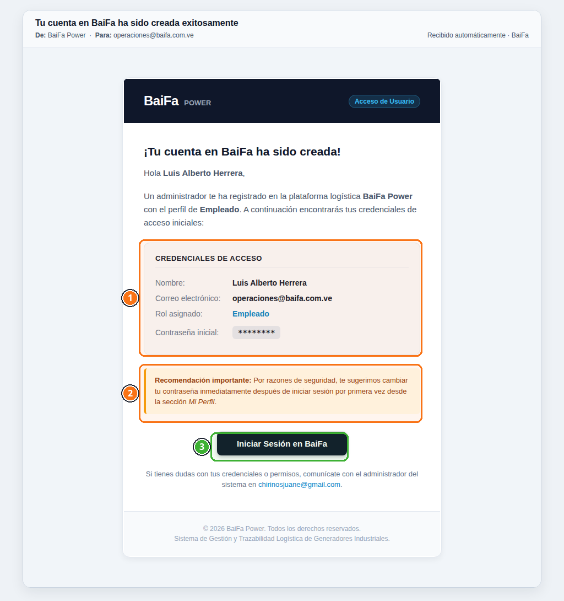

| N.º | Elemento / Acción señalada | Qué hace |
| :---: | :--- | :--- |
| **1** | **Credenciales de acceso iniciales** | Muestra el nombre del colaborador, su correo corporativo, el cargo asignado y la contraseña inicial definida por el administrador. |
| **2** | **Recomendación de cambio de clave** | Indica al usuario cambiar su contraseña inmediatamente después de ingresar por primera vez desde la sección 'Mi Perfil'. |
| **3** | **Botón 'Iniciar Sesión en BaiFa' y soporte** | Abre directamente el acceso a la plataforma y muestra el correo del administrador ante cualquier duda con sus permisos. |

#### 10.4. Correo de Nuevo Punto de Control / Avance en Ruta
Se dispara automáticamente cada vez que el equipo operativo registra un punto de control o cambia de etapa un generador asignado a un cliente (desde Generadores o Rastrear). El asunto y los colores del aviso se adaptan si el equipo está en tránsito, en Almacén BaiFa o ya fue Entregado.

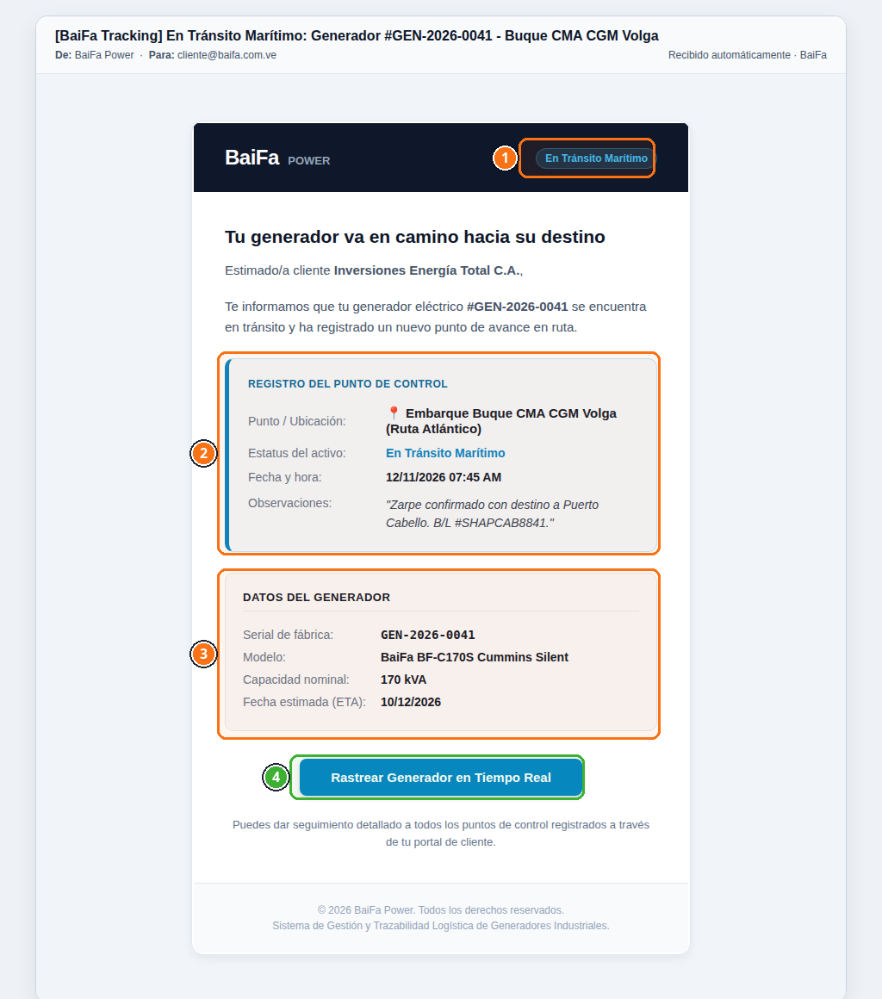

| N.º | Elemento / Acción señalada | Qué hace |
| :---: | :--- | :--- |
| **1** | **Etiqueta de estado alcanzado** | Muestra arriba a la derecha la etapa logística actual del generador (por ejemplo: En Tránsito Marítimo, En Almacén BaiFa o Entregado). |
| **2** | **Registro del Punto de Control** | Detalla el lugar exacto o hito reportado, el estatus del activo, fecha y hora del evento y las observaciones del operador (buque, placa, chofer, etc.). |
| **3** | **Datos del generador** | Confirma el serial de fábrica, modelo, capacidad nominal en kVA y la fecha estimada de llegada (ETA). |
| **4** | **Botón 'Rastrear Generador en Tiempo Real'** | Con un solo clic abre la línea de tiempo completa de ese equipo en la plataforma. |

#### 10.5. Correo de Actualización de Ficha o Cambio de Estatus
Se envía automáticamente cuando un Administrador, Gerente o Empleado edita información importante de un generador asignado a un cliente (por ejemplo: cambia la fecha estimada de llegada ETA, el modelo, las observaciones o el estado desde Editar Generador).

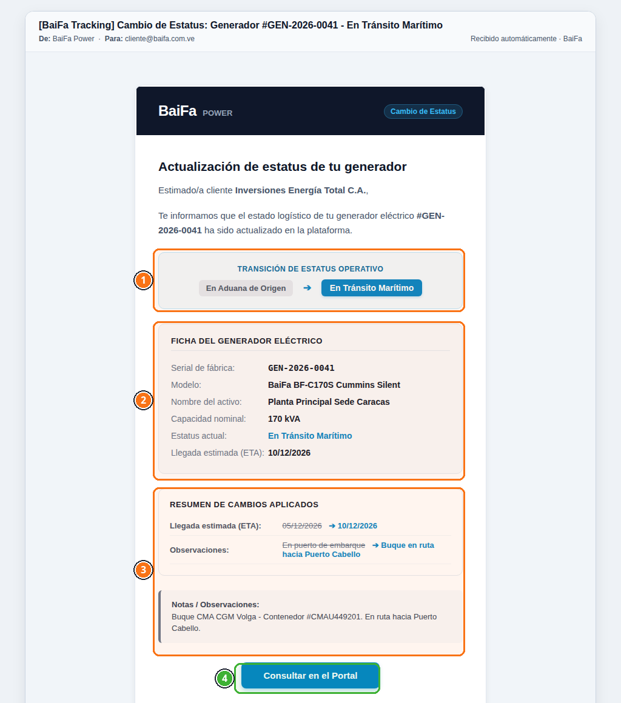

| N.º | Elemento / Acción señalada | Qué hace |
| :---: | :--- | :--- |
| **1** | **Transición de estatus operativo** | Cuando cambia la etapa logística, muestra visualmente el estado anterior y el nuevo estado alcanzado. |
| **2** | **Ficha actualizada del generador** | Presenta los datos vigentes completos del equipo (serial, modelo, nombre, kVA, estatus actual y ETA). |
| **3** | **Resumen de cambios aplicados** | Muestra claramente qué campos cambiaron (tachando el valor anterior y resaltando en azul el nuevo valor) junto a las observaciones actuales. |
| **4** | **Botón 'Consultar en el Portal'** | Permite al cliente abrir de inmediato la vista de seguimiento del generador actualizado. |

---

## ❓ Preguntas Frecuentes (FAQ)

<strong>¿Qué pasa si un operador se equivoca al escribir una nota o punto de control?</strong>

Por transparencia y confianza para el cliente, los puntos de control ya registrados quedan sellados como parte de la bitácora histórica y no se editan ni borran. Si hubo una aclaratoria, simplemente registra un nuevo checkpoint de corrección o actualización explicando el dato correcto en las observaciones.

<strong>¿El sistema rastrea los generadores por GPS automático?</strong>

No. BaiFa Power Tracking trabaja bajo control operativo 100% manual y auditado: cada avance es registrado por personal autorizado de BaiFa (en fábrica, aduana, puerto, almacén o entrega), evitando errores por pérdida de señal GPS en contenedores marítimos.

<strong>¿El cliente recibe algún aviso cuando su planta eléctrica avanza de etapa o cambia su fecha ETA?</strong>

Sí. Cada vez que un Administrador, Gerente o Empleado registra un punto de control o modifica datos importantes (como la fecha estimada de llegada) de un generador asignado a un cliente, el sistema envía automáticamente un correo electrónico institucional con el detalle y un botón directo al rastreo.

<strong>¿Por qué un Empleado no ve la pestaña de Usuarios ni la de Reportes?</strong>

Por seguridad interna de la empresa. El perfil Empleado está diseñado para agilizar el trabajo diario (cargar generadores, subir fotos, registrar checkpoints y consultar teléfonos de clientes) sin exponer reportes financieros/ejecutivos ni permitir borrar empresas o cuentas.

<strong>¿Qué formatos de RIF, teléfono y foto acepta el sistema?</strong>

Los formularios ayudan automáticamente mientras escribes: RIF venezolano (ej. J-12345678-9 o Cédula V-12345678), teléfonos nacionales o internacionales (ej. 0414-1234567 o +58 414-1234567), seriales de equipo (ej. GEN-2026-0041) y fotografías en formato JPEG, PNG o WebP de hasta 5 MB.

<strong>¿Se pueden abrir los reportes descargados directamente en Microsoft Excel?</strong>

Sí. Al presionar 'Exportar CSV' en el módulo de Reportes, el archivo se descarga preparado para que Microsoft Excel lo abra directamente en columnas ordenadas y reconociendo correctamente tildes y la letra ñ.

